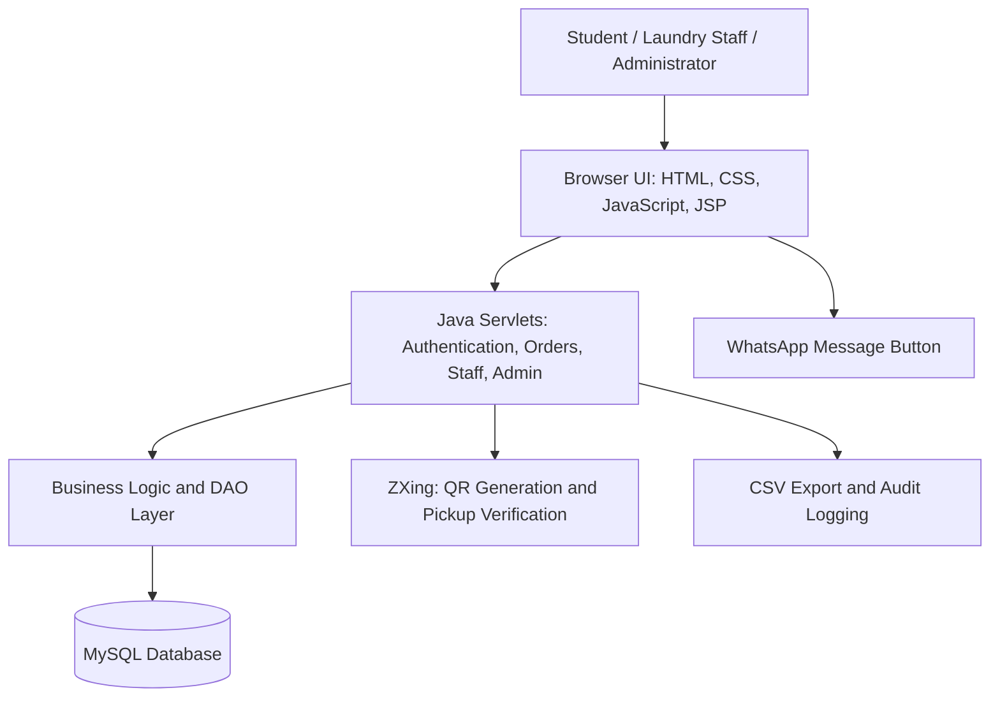

# 🧺 STITCHTRACK
### Smart Laundry Management & Tracking System

**A Java-Based Web Application | Project Based Learning (PBL) | Academic Session 2026–27**  
**Arya College | 5th Semester**

> A centralized, role-based platform for managing student laundry requests, garment verification, bag assignment, processing, pickup verification, and administrative oversight.

---

## 🔗 Quick Access — Project Links

| Resource | Access |
|---|---|
| 🌐 **Live Web Application** | **[Open StitchTrack](https://stitchtrack-laundry.onrender.com/login)** |
| 🎓 **Student Registration** | **[Create Student Account](https://stitchtrack-laundry.onrender.com/register)** |
| 🎓 **Student Login** | [Open Student Login](https://stitchtrack-laundry.onrender.com/login) |
| 👕 **Laundry Staff Portal** | [Open Staff Login](https://stitchtrack-laundry.onrender.com/login) |
| 🛡️ **Administrator Portal** | [Open Admin Login](https://stitchtrack-laundry.onrender.com/login) |
| 📂 **Project Documentation (Google Drive)** | **[View Reports, Diagrams & Documents](https://drive.google.com/drive/folders/1V0ByjtK1Nl2-7s7G9ep2PmALelME2Mc5?usp=sharing)** |
| 💻 **GitHub Source Code** | **[View Repository](https://github.com/abhayshekhawat12/stitchtracker-java)** |
| 📋 **Feature Mapping** | [View Java Feature Mapping](https://github.com/abhayshekhawat12/stitchtracker-java/blob/main/FEATURE_MAPPING.md) |
| 🚀 **Deployment Instructions** | [View Deployment Guide](https://github.com/abhayshekhawat12/stitchtracker-java/blob/main/DEPLOYMENT.md) |

> **Faculty evaluation note:** The above links point to the publicly deployed StitchTrack web application on Render. If the service is temporarily unavailable, the source code, deployment guide, and project documentation are available through the links above.

## 🔐 Demo Login Credentials

The following accounts are intended **only for academic demonstration and evaluation**.

| User Role | Email / Login | Password | Instructions |
|---|---|---|---|
| **Administrator** | `admin@stitchtrack.local` | `admin123` | Open the application and choose Admin Login. |
| **Laundry Staff** | `laundrystaff@stitchtrack.com` | `laundry@staff123` | Open the application and choose Staff Login. |
| **Student** | **Self-registration** | **Set during registration** | Register as a new student; admin approval may be required before access. |

> ⚠️ **Security:** These are demonstration credentials, not production-safe accounts. Replace all publicly shared passwords before deploying with real student or institutional data.

---

## 👥 Project Team

**Project:** STITCHTRACK — Laundry Management System  
**Program:** Project Based Learning (PBL), 5th Semester  
**Academic Session:** 2026–27  
**Institution:** Arya College

| Team Member | Roll Number | Position |
|---|---|---|
| **AKHILESH VYAS** | `24EARAD009` | Team Lead |
| **ABHAY SHEKHAWAT** | `24EARAD002` | Team Member |
| **AASHI GANDHI** | `24EARAD001` | Team Member |
| **ARYA GUPTA** | `24EARAD019` | Team Member |
| **ARCHI SINHA** | `24EARAD018` | Team Member |

### Individual Team Member Contributions

The team worked collaboratively across the full development lifecycle. The table below highlights each member's **main areas of contribution** for faculty review.

| Team Member | Key Contributions / Work Done |
|---|---|
| **AKHILESH VYAS (Team Lead)** | Java web application structure, authentication and session management, student/staff/admin workflow integration, laundry request and status processing, QR-based delivery integration, security review, and overall project coordination. |
| **ABHAY SHEKHAWAT** | MySQL database design, JDBC and DAO implementation, user/order/quota data management, bag assignment and pipeline backend logic, QR delivery data handling, analytics, CSV export, and database testing. |
| **AASHI GANDHI** | Student registration and verification flow, laundry request and order-history modules, staff bag-assignment and processing workflow, admin verification, quota renewal and complaint workflows, functional testing, and documentation. |
| **ARYA GUPTA** | Student dashboard and laundry request testing, order history and quota validation, staff workflow and QR-based pickup testing, admin and complaint-module verification, bug reporting, integration testing, and documentation support. |
| **ARCHI SINHA** | Frontend UI/UX for login and student/staff/admin dashboards, laundry request and history screens, bag assignment and pipeline interfaces, QR scanner and delivery screens, responsive layouts, and UI testing. |

> **Teamwork note:** These are primary contribution areas, not exclusive ownership of modules; all five members participated in planning, integration, reviews, testing, and project presentation.

---

## 📌 Project Overview

**StitchTrack** is a Java-based web application designed to digitize laundry operations in colleges, hostels, and residential institutions. It replaces handwritten registers and informal status updates with a structured system connecting **students, laundry staff, and administrators**.

Students can submit laundry requests and track orders. Staff can confirm garment counts, assign bags, update processing stages, and verify collection through QR codes. Administrators can approve registrations, supervise laundry operations, manage quotas, review complaints, and export records.

### 🎯 Project Objectives

- Digitize student laundry registration, booking, and tracking.
- Reduce errors in garment counts, bag handling, and order handover.
- Provide transparent order history and processing status.
- Support secure, QR-based verification during pickup.
- Manage laundry quotas and semester renewal requests.
- Give staff and administrators a unified operational workflow.
- Maintain accountability with audit records and CSV reporting.

## ✨ Main Features

### 🎓 Student Module

- Student registration with administrative verification.
- Secure login and personalized student dashboard.
- New laundry request with garment types and quantities.
- Quota availability and usage tracking.
- Laundry request status and previous order history.
- Pickup QR code for order verification.
- Quota renewal request submission.
- Complaint or garment-mismatch reporting.

### 👕 Laundry Staff Module

- Staff dashboard for incoming and active laundry requests.
- Physical garment-count verification and request confirmation.
- Numeric laundry bag assignment and order association.
- Active laundry pipeline and stage-wise status updates.
- Marking processed orders as ready for pickup.
- WhatsApp message button for pickup communication.
- QR scanner and manual token fallback for pickup verification.
- Final garment delivery and order completion.

### 🛡️ Administrator Module

- Admin dashboard and system overview.
- Student registration approval/rejection and account management.
- Laundry order and staff-operation monitoring.
- Student quota administration and renewal approval.
- Complaint review and resolution workflows.
- Operational analytics, records, and audit logs.
- CSV data export for reporting and evaluation.

---

## 🔄 Complete Laundry Management Workflow

1. **Student Registration:** A student creates an account and awaits verification when approval is required.
2. **Laundry Request:** The verified student submits garment types and quantities through the student dashboard.
3. **Request Review:** Laundry staff receives the request and checks the submitted garment details against the clothes collected.
4. **Bag Assignment & Confirmation:** Staff assigns a bag number, finalizes garment details, and confirms the order.
5. **Laundry Processing:** The confirmed order enters the active laundry pipeline; staff updates the order as processing progresses.
6. **Ready for Pickup:** Once garments are processed, staff marks the order ready and can use the WhatsApp button to inform the student.
7. **QR Verification:** At collection, the student presents the pickup QR code; staff scans it or uses manual verification.
8. **Delivery & Records:** After successful verification, staff completes delivery and the transaction remains available in order history.

```text
STUDENT REGISTRATION
        ↓
ADMIN VERIFICATION
        ↓
STUDENT SUBMITS LAUNDRY REQUEST
        ↓
STAFF VERIFIES GARMENTS
        ↓
BAG ASSIGNMENT + REQUEST CONFIRMATION
        ↓
ACTIVE LAUNDRY PROCESSING PIPELINE
        ↓
READY FOR PICKUP + WHATSAPP MESSAGE OPTION
        ↓
STUDENT PRESENTS PICKUP QR
        ↓
STAFF SCANS / VERIFIES TOKEN
        ↓
DELIVERY COMPLETED + ORDER HISTORY UPDATED
```

## 🧪 Suggested Faculty Demo

For a complete demonstration, follow the real operational sequence:

1. Open the **Live Web Application** from the first table.
2. Register a new student account using the **Student Registration** link.
3. Sign in as **Admin** and verify the student's account.
4. Sign in as **Student** and submit a laundry request.
5. Sign in as **Laundry Staff**, verify the garments, and assign a bag.
6. Update the request through the laundry processing pipeline and mark it ready for pickup.
7. Open the student's pickup QR code and use the staff scanner (or manual token option) to verify delivery.
8. Check the updated order history, quota, administration, and reporting areas.

---

## 🛠️ Technology Stack

| Layer | Technology |
|---|---|
| Programming Language | **Java 17** |
| Server-Side Web | **Jakarta Servlets 6, JSP** |
| Frontend | **HTML, CSS, JavaScript** |
| Database | **MySQL 8+** |
| Database Access | **JDBC, DAO pattern, HikariCP** |
| Web Server / Container | **Apache Tomcat 10.1+** |
| Build & Dependency Management | **Apache Maven** |
| QR Code Implementation | **ZXing** |
| Password Security / Sessions | **BCrypt, HttpSession** |
| Logging | **SLF4J / Logback** |
| Deployment Support | **Docker, Docker Compose, Render configuration** |
| Additional Interface Features | **WhatsApp message link/button, PWA shell** |

## 🏗️ System Architecture

The application follows a layered Java web architecture with separated presentation, request handling, business/data access, and persistence responsibilities.



### Primary Data Areas

- User accounts, verification, and role-based access.
- Laundry orders and garment items.
- Bag allocation and laundry processing status.
- Student quota and renewal requests.
- Pickup QR tokens and delivery verification.
- Complaints, audit logs, and operational records.

## 📁 Repository Structure

```text
stitchtracker-java/
├── database/
│   └── stitchtrack_mysql.sql     # Database schema/setup
├── src/
│   └── main/                     # Java application + web resources
├── pom.xml                       # Maven configuration
├── Dockerfile                    # Containerized build/deployment
├── docker-compose.yml            # Container service setup
├── render.yaml                   # Render deployment configuration
├── DEPLOYMENT.md                 # Deployment instructions
├── FEATURE_MAPPING.md           # Functional mapping
└── README.md                     # Project overview and guide
```

## 💻 How to Run Locally

### Prerequisites

- JDK **17**
- Apache Maven
- MySQL **8+**
- Apache Tomcat **10.1+**
- Eclipse IDE / IntelliJ IDEA / another compatible Java IDE

### 1. Clone the Repository

```bash
git clone https://github.com/abhayshekhawat12/stitchtracker-java.git
cd stitchtracker-java
```

### 2. Set Up MySQL

Import or execute the SQL file:

```text
database/stitchtrack_mysql.sql
```

Default database name: `stitchtrack_java`.

### 3. Configure Database Connection

Set these environment variables for your local MySQL installation:

```bash
STITCHTRACK_DB_URL=jdbc:mysql://localhost:3306/stitchtrack_java?useSSL=false&allowPublicKeyRetrieval=true&serverTimezone=Asia/Kolkata
STITCHTRACK_DB_USER=your_mysql_username
STITCHTRACK_DB_PASSWORD=your_mysql_password
```

Configure the variables in your operating system, IDE, or Tomcat runtime environment. **Do not commit real database passwords to GitHub.**

### 4. Build and Deploy

```bash
mvn clean package
```

Deploy the generated `target/stitchtrack.war` to **Tomcat 10.1+**, or import the folder in Eclipse as an **Existing Maven Project** and select **Run on Server**.

### 5. Open the Application

```text
http://localhost:8080/stitchtrack/
```

> The application context may differ in deployments configured to serve the WAR at the root URL. See [DEPLOYMENT.md](https://github.com/abhayshekhawat12/stitchtracker-java/blob/main/DEPLOYMENT.md) for deployment-specific instructions.

---

## 📚 Academic Documentation

Project documents, diagrams, reports, and related academic material are available in the **[Project Google Drive Folder](https://drive.google.com/drive/folders/1V0ByjtK1Nl2-7s7G9ep2PmALelME2Mc5?usp=sharing)**.

For an implementation-oriented reference, see the repository's **[Feature Mapping](https://github.com/abhayshekhawat12/stitchtracker-java/blob/main/FEATURE_MAPPING.md)** and **[Deployment Guide](https://github.com/abhayshekhawat12/stitchtracker-java/blob/main/DEPLOYMENT.md)**.

---

<div align="center">

**STITCHTRACK — Digitizing Campus Laundry Management**

*Developed as a Java-based Project Based Learning initiative | Academic Session 2026–27*

**Arya College**

</div>
